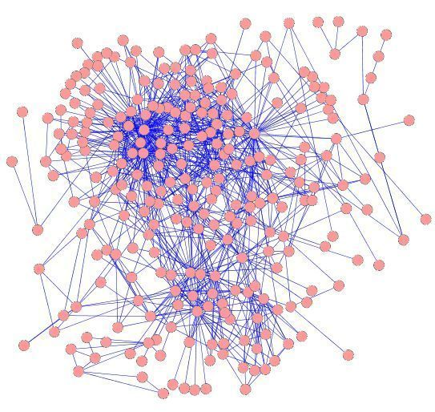

<div align="center">


# MI-GRAAL (Matching-based Integrative GRAph ALigner) Algorithm

**Oleksii Kuchaiev and Nataša Pržulj**

Corresponding author: Prof. N. Pržulj, natasa.przulj@mbzuai.ac.ae



</div>

## Downloads

- [Download MI-GRAAL](https://github.com/przulj-lab/MI-GRAAL/releases/download/v1.0/MI-GRAAL.tar.gz)
- [Supplementary information](https://github.com/przulj-lab/MI-GRAAL/releases/download/v1.0/ALL_SI.zip): Supplementary Figure 1 and Supplementary Files 1–3, as one zip file

## How to run MI-GRAAL

- MI-GRAAL has been tested on Gentoo and Mandriva Linux, but should work on other distributions.
- Download and unpack MI-GRAAL using the link above.
- MI-GRAAL accepts networks in LEDA `.gw` format.
- You need Python installed.
- Run `./MI-GRAALRunner.py` without parameters to see usage directions.
- The number of nodes in the first network must not be greater than the number of nodes in the second network.

## Example

In the folder where you unpacked MI-GRAAL:
```bash
./MI-GRAALRunner.py testGraph1.gw testGraph2.gw result -p 3
```

## Converting an edge list to `.gw`

If your network is an edge list:
```
node1 node2
node3 node4
...
```
convert it with the `list2leda` script included in the MI-GRAAL download:
```bash
./list2leda edgelist.txt >> graph.gw
```
Self-loops, edge directions and duplicate edges are ignored.

## Other network alignment algorithms

- [IsoRank and IsoRankN](https://cb.csail.mit.edu/cb/mna/)
- [GRAph ALigner (GRAAL)](https://github.com/przulj-lab/GRAAL)
- (PathBlast](https://karlan.com/)
- [GraphM package](https://www.minesparis.psl.eu/cbio/)
- [Natalie](https://www.mi.fu-berlin.de/w/LiSA/Natalie)

## Citation

O. Kuchaiev and N. Pržulj. Integrative network alignment reveals large regions of global network similarity in yeast and human. *Bioinformatics* 27(10), 1390–1396 (2011). https://doi.org/10.1093/bioinformatics/btr127
